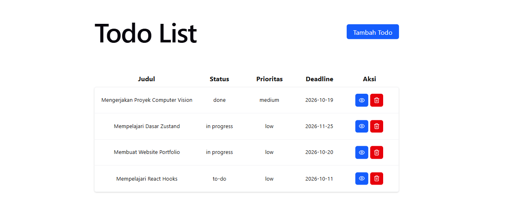
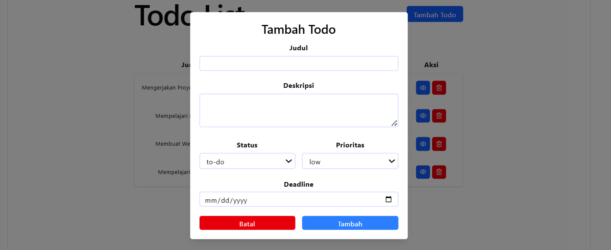
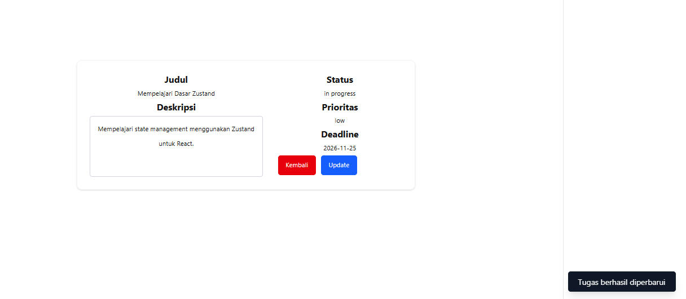
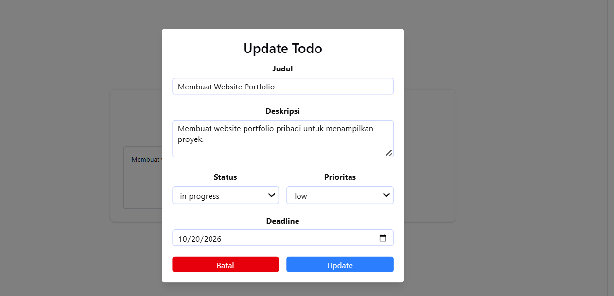

# Todo List - React.js

Aplikasi To-Do List frontend (React + Vite + Tailwind CSS) dengan data dummy.

## Fitur
- Menampilkan, melihat detail, menambah, memperbarui, dan menghapus tugas , Notifikasi setelah tambah, update, dan hapus

## Cara Menjalankan
npm install
npm run dev

## Screenshot

